# Dashboard de custos de importação

> Recriação com dados fictícios, inspirada em um problema real de importação.

Painel analítico em HTML estático que responde, em poucos cliques, três perguntas de quem acompanha importação: **quanto custou, de onde vem o custo e onde a reposição está em risco**. Marca fictícia: Gutenberg Systems.

**Demo:** https://prodigyb0y.github.io/dashboard-importacao/

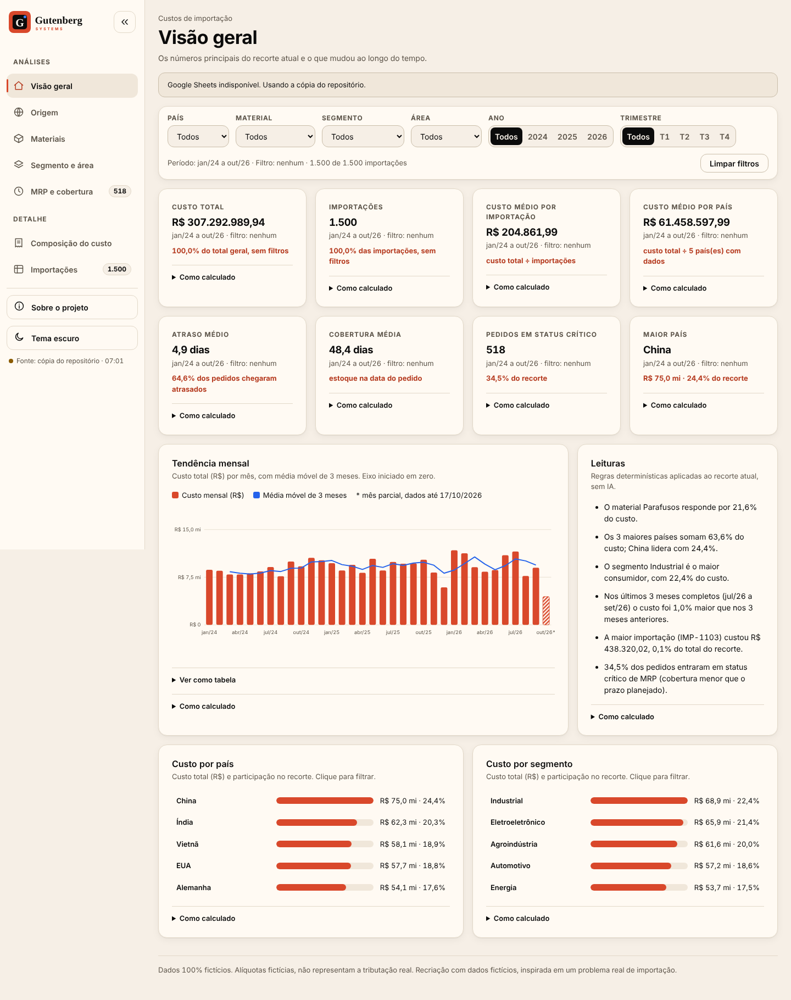

## Sumário

1. [Problema](#problema)
2. [O que o painel mostra](#o-que-o-painel-mostra)
3. [Como ele ajuda a operação](#como-ele-ajuda-a-operação)
4. [Dados](#dados)
5. [Como rodar localmente](#como-rodar-localmente)
6. [Método de conferência](#método-de-conferência)
7. [Decisões técnicas](#decisões-técnicas)
8. [Limitações](#limitações)
9. [Ferramentas usadas](#ferramentas-usadas)
10. [Sobre a origem](#sobre-a-origem)

## Problema

Em importação, o custo final em reais só aparece depois de somar mercadoria, frete, seguro e encargos, convertidos pelo câmbio de cada pedido. Responder perguntas simples ("quanto custou a China em 2025?", "quais pedidos estão com cobertura abaixo do prazo?") obriga a refazer filtros e somas em planilha a cada vez, e custo e abastecimento costumam ficar em visões separadas. O painel junta as duas coisas e escreve, em cada indicador, qual período e qual filtro foram usados.

## O que o painel mostra

Filtros globais (país, material, segmento, área, ano e trimestre) valem para todas as telas. Em cada cartão, "Como calculado" mostra a regra.

### Visão geral
Custo total, número de importações, custo médio por importação e por país, atraso médio, cobertura média, pedidos críticos e maior país, mais a tendência mensal (com média móvel de 3 meses e o mês parcial sinalizado) e leituras geradas por regras fixas.

### Origem, com mapa
Custo por país em mapa (cor e círculo proporcionais ao custo; clicar no país aplica o filtro), top 10 fornecedores e composição do custo por país.

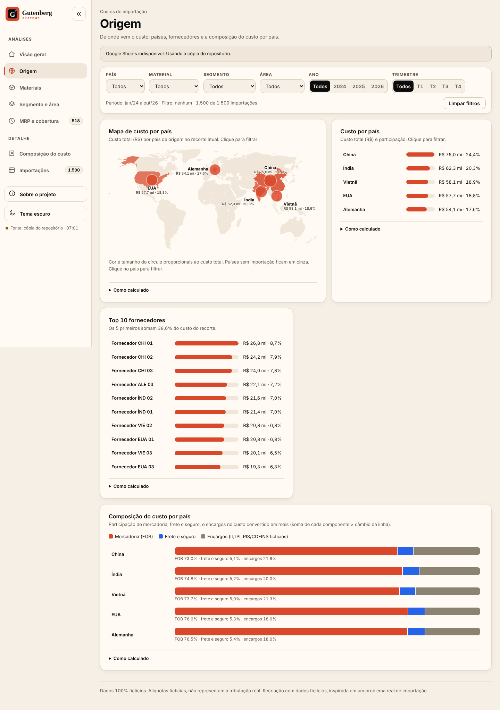

### Materiais
Custo por material, custo médio por importação, matriz país × material (células com poucas importações são sinalizadas) e quantidade importada.

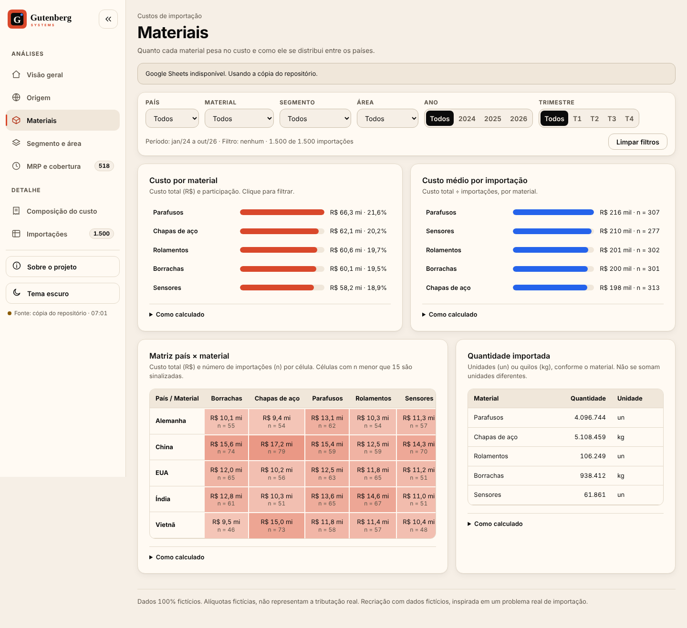

### Segmento e área
Custo por segmento de negócio e por área solicitante, matriz segmento × área e risco de abastecimento por segmento.

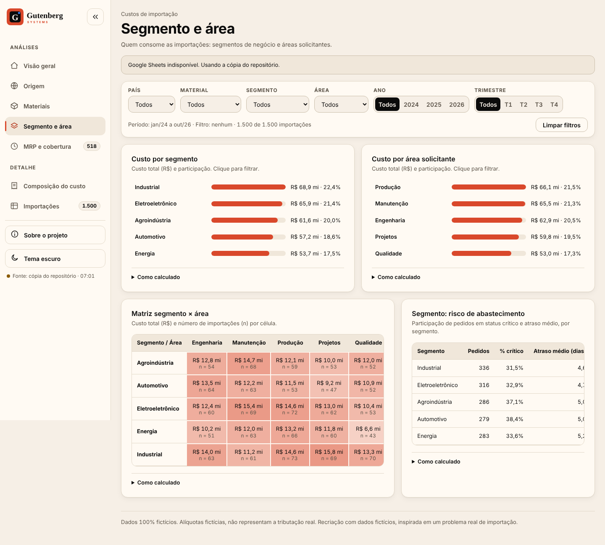

### MRP e cobertura
Pedidos por status (crítico, atenção, adequado), pedidos abaixo do ponto de pedido, prazo planejado versus efetivo por país e os 10 pedidos mais críticos.

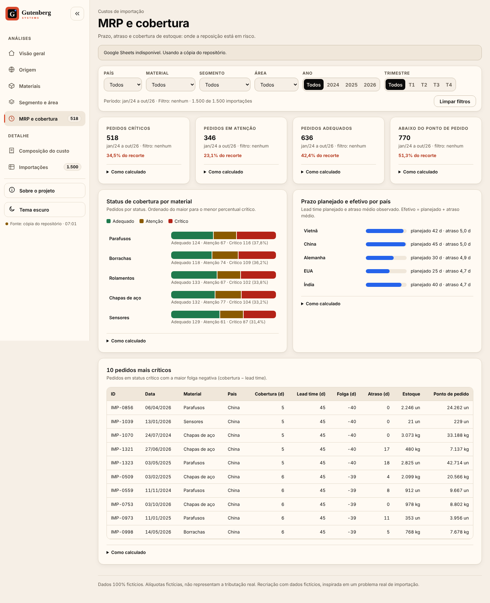

### Composição do custo
Da mercadoria ao custo final: FOB, frete, seguro, encargos e o ajuste de arredondamento.

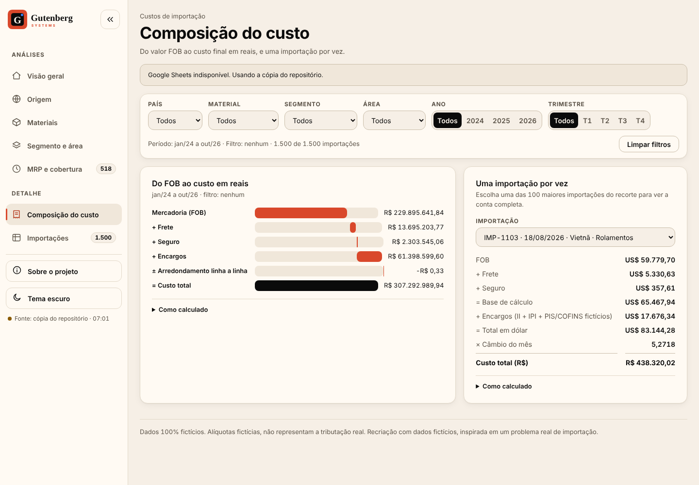

### Importações
Tabela com busca, ordenação e paginação, para chegar ao pedido individual.

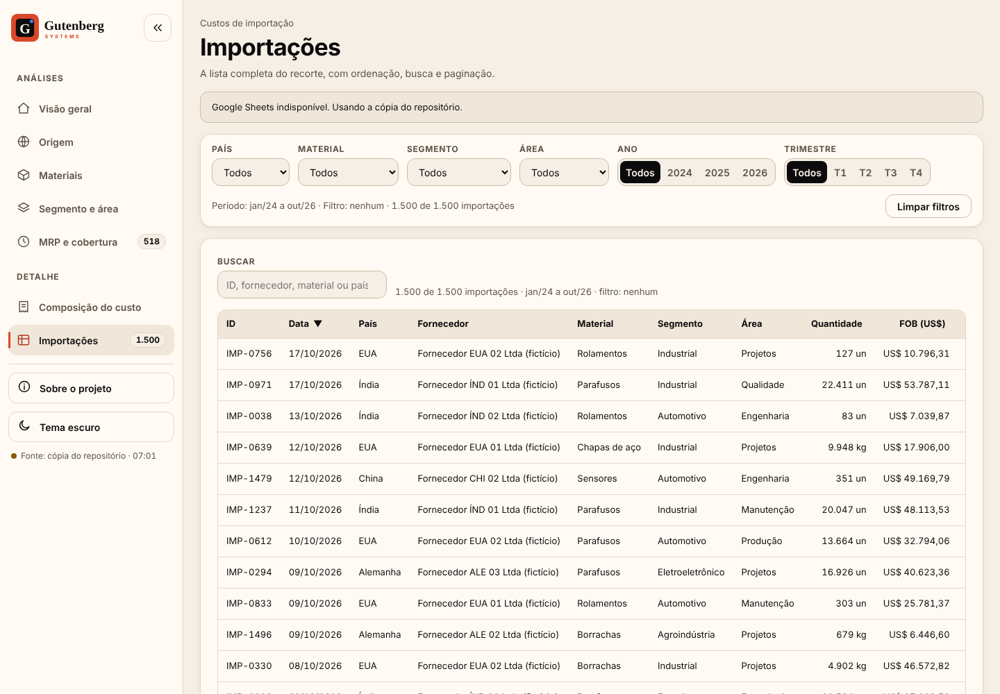

### Filtros, pop-up "Sobre" e tema
Clicar em um país do mapa ou em uma barra filtra todo o painel. O botão "Sobre o projeto" abre um pop-up com o problema, as decisões que o painel apoia e os limites. Há tema claro e escuro e layout para celular.

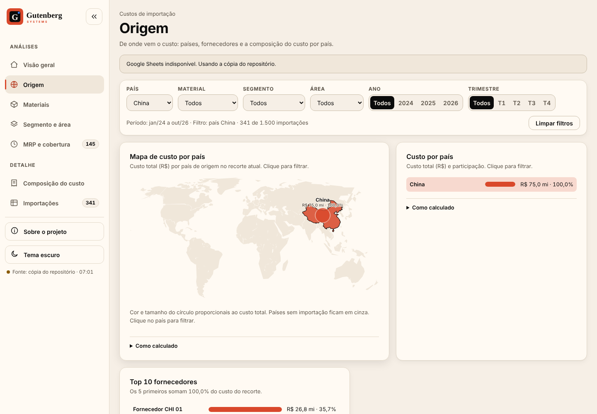
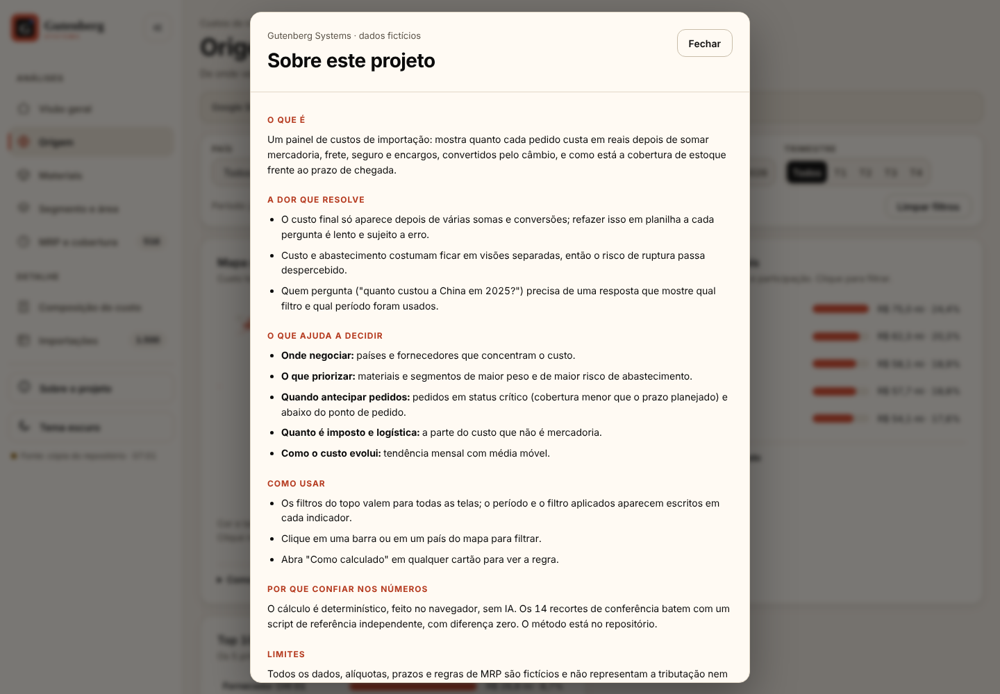
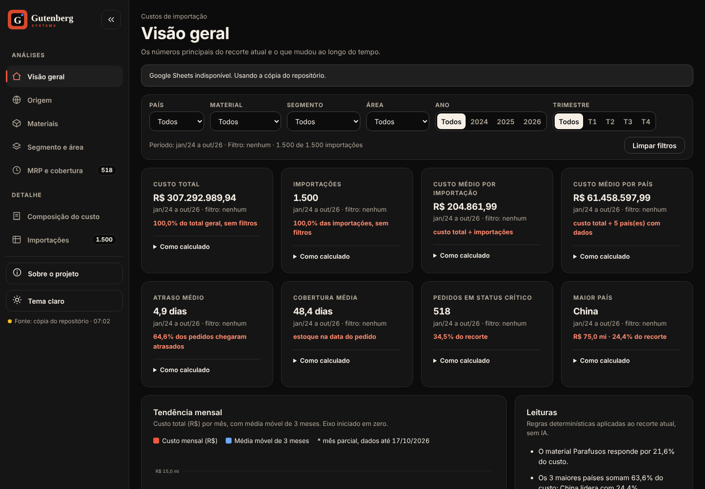

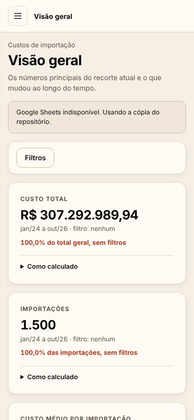

Estados tratados: carregando, nenhum resultado para os filtros (com botão para limpar) e erro de carregamento (com nova tentativa e envio manual do CSV).

## Como ele ajuda a operação

O ganho está em **ler custo e risco juntos, com o filtro à vista, sem refazer conta**. Alguns exemplos de leitura que o painel entrega em segundos, calculados sobre os dados fictícios deste repositório:

- **Onde concentrar a negociação.** A China responde por 24,4% do custo total, seguida de Índia (20,3%), Vietnã (18,9%), EUA (18,8%) e Alemanha (17,6%). O mapa e o top 10 de fornecedores mostram onde um ganho de preço ou de frete pesa mais.
- **Onde a reposição está em risco.** 518 dos 1.500 pedidos (34,5%) entraram em status crítico, isto é, com estoque cobrindo menos dias do que o prazo planejado de chegada. Por país, o percentual crítico vai de 23,3% (EUA) a 42,5% (China). Esse contraste orienta onde antecipar pedido ou rever estoque de segurança.
- **O que é mercadoria e o que é custo de trazer.** A mercadoria (FOB) representa 74,8% do custo em reais, os encargos 20,0% e frete e seguro 5,2%. Isso mostra o quanto do custo depende de tributo e logística, e não do preço de compra.
- **Quais pedidos olhar primeiro.** A lista dos 10 pedidos mais críticos ordena por folga negativa (cobertura menos prazo planejado), o que dá uma fila de ação pronta.
- **Resposta rastreável.** Todo número traz período, filtro e regra de cálculo, e os recortes foram conferidos contra um script independente (ver abaixo). Quem recebe o número sabe de onde ele veio.

Esses valores são de dados inventados, servem só para demonstrar o tipo de leitura; em uma operação real, a mesma estrutura seria alimentada com os pedidos verdadeiros e com as regras de tributação e de MRP da empresa. O painel apoia a decisão: ele organiza e mostra, não decide pelo usuário.

## Dados

Todos os dados são fictícios e gerados por `gerar_dados.py` (semente fixa `20261123`): 1.500 importações de jan/2024 a out/2026, 5 países, 5 materiais, 5 segmentos e 5 áreas. **As alíquotas (II, IPI, PIS/COFINS), os prazos, o câmbio e as colunas de MRP são fictícios e não representam a tributação nem a operação reais.**

Fonte no painel: primeiro tenta a planilha do Google Sheets; se falhar ou estiver com colunas faltando, usa `docs/data/importacoes.csv`; se também falhar, mostra erro e permite enviar o CSV manualmente.

## Como rodar localmente

```
git clone https://github.com/Prodigyb0y/dashboard-importacao
cd dashboard-importacao/docs
python3 -m http.server 8000
```

Abra http://localhost:8000. Abrir o arquivo direto, sem servidor, impede o carregamento do CSV.

Regerar dados e gabarito: `python3 gerar_dados.py` e depois `python3 referencia.py`.

## Método de conferência

`referencia.py` calcula 14 recortes de forma independente do painel (Python, `Decimal`, arredondamento meio para cima) e grava `docs/data/gabarito_recortes.json`. `docs/conferir_dashboard.py` abre o painel em um navegador automatizado (Playwright + Chrome), aplica cada filtro e compara custo total, número de importações, atraso médio, cobertura média e pedidos críticos com o gabarito. Resultado: **14 de 14 recortes com diferença zero.** Detalhes em [`docs/conferencia.md`](docs/conferencia.md).

| Recorte | Importações | Custo total (R$) |
|---|---|---|
| R01 total geral | 1500 | 307.292.989,94 |
| R02 país China | 341 | 75.041.961,00 |
| R03 país Índia | 295 | 62.345.085,62 |
| R04 material Rolamentos | 302 | 60.621.633,28 |
| R05 material Sensores | 277 | 58.152.488,94 |
| R06 China + Rolamentos | 59 | 12.457.987,75 |
| R07 ano 2024 | 543 | 106.187.412,70 |
| R08 ano 2025 | 529 | 108.412.591,91 |
| R09 ano 2026 | 428 | 92.692.985,33 |
| R10 1º trimestre 2026 | 153 | 32.070.703,75 |
| R11 segmento Automotivo | 279 | 57.224.417,50 |
| R12 área Manutenção | 324 | 65.489.355,33 |
| R13 Alemanha + Sensores | 57 | 11.262.627,44 |
| R14 segmento Energia + área Projetos + 2025 | 22 | 4.268.018,60 |

## Decisões técnicas

- **HTML, CSS e JavaScript puros em um único arquivo** (`docs/index.html`), sem build e sem dependências em tempo de execução. Funciona no GitHub Pages sem servidor próprio.
- **Valores em centavos inteiros** e médias com arredondamento meio para cima em inteiros, para bater com o script de referência em Decimal.
- **Tokens de design** (cor, fonte, raio, espaçamento) em variáveis CSS, com tema claro e escuro.
- **Movimento discreto** (barras que crescem, linha que se desenha, cartões que entram), desligado quando o usuário pede menos movimento (`prefers-reduced-motion`).
- **Acessibilidade:** rótulos em todos os campos, foco visível, navegação por teclado (inclusive no mapa), um único título por página e alternativa em texto para o mapa (as barras de custo por país).
- **Sem IA no painel.** As "leituras" são frases geradas por regras fixas.
- **Sem chamadas externas** além da leitura opcional da planilha; fonte Inter e geometria do mapa ficam no repositório.

## Limitações

- Dados e alíquotas fictícios: não servem para decisão real.
- A conferência compara o dashboard com um script que usa as mesmas regras de negócio; ela prova que a soma e os filtros estão corretos, não que as regras fictícias correspondem a alguma operação real.
- O arquivo exportado do Google Sheets tem formatação numérica diferente do CSV do repositório (o sha256 difere); os valores conferem.
- O mapa usa geometria simplificada (Natural Earth 1:110m, domínio público) e só destaca os 5 países de origem.
- Os 14 recortes foram conferidos localmente; na página publicada foi conferido o carregamento e o filtro, não os 14 recortes.
- Não há medição de tempo ou de ganho de horas neste projeto, e nenhum ganho é afirmado.

## Ferramentas usadas

v0 nas primeiras versões da interface; depois o HTML/CSS/JS foi escrito à mão (arquivo único `docs/index.html`) com apoio do Claude (Anthropic). Verificação com Playwright e Chrome. Fonte Inter (licença SIL OFL) incluída localmente. Hospedagem: GitHub Pages (branch `main`, pasta `/docs`).

## Sobre a origem

Este projeto recria, com dados inventados, um padrão de leitura que o autor viveu em rotinas de importação. Não usa nome, marca, tela, cor, layout nem sistema de nenhuma empresa real.
